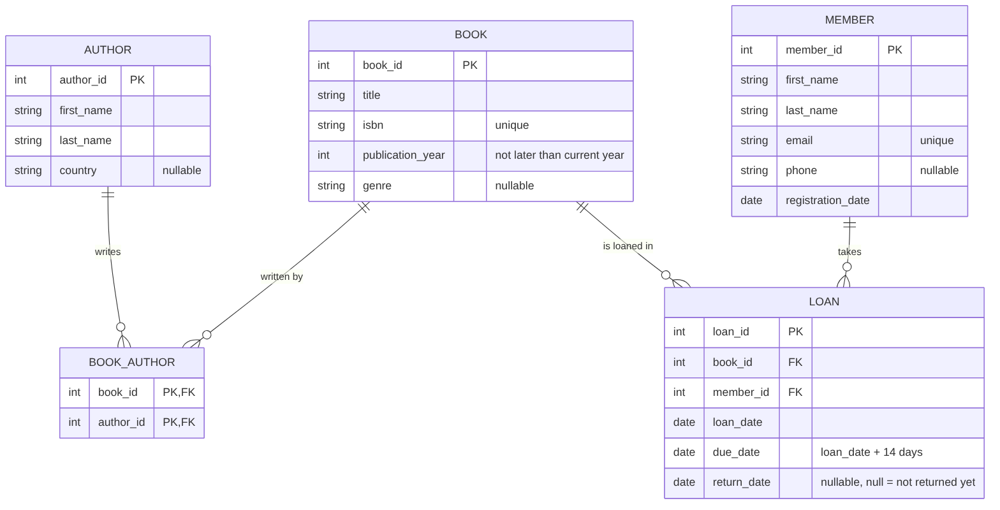

# Лабораторна робота 1: Збір вимог та ER-діаграма

**Тема:** Система управління бібліотекою
**Виконали:** Слив'юк Вікторія, Семенюк Ліліана — група ІМ-52 - без захисту

## 1. Вимоги

**Ролі:** Семенюк Ліліана — зацікавлена сторона (бібліотекар), Слив'юк Вікторія — аналітик.

**Призначення системи:** облік книг, авторів, читачів і видачі книг у бібліотеці.

**Дані, які треба зберігати:**

- Книги: назва, ISBN, рік видання, жанр.
- Автори: ім'я, прізвище, країна.
- Учасники (читачі): ім'я, прізвище, email, телефон, дата реєстрації.
- Позики: яка книга, який учасник, дата видачі, термін повернення, дата повернення.

**Бізнес-правила:**

1. Книга може мати одного або кількох авторів; автор може написати багато книг.
2. Книга видається на 14 днів.
3. Учасник може мати одночасно не більше 5 неповернених книг.
4. Книгу, яка зараз на руках, не можна видати іншому учаснику.
5. ISBN книги та email учасника — унікальні.

**Завдання користувачів:** зареєструвати учасника; додати книгу з авторами; видати книгу; прийняти книгу; знайти книгу за назвою чи автором; переглянути книги на руках в учасника; переглянути боржників.

## 2. ER-діаграма

Код діаграми (Mermaid): [erDiagram.mmd](erDiagram.mmd)

## 3. Сутності та атрибути

| Сутність                  | Атрибути                                                          | Ключі                                                            |
| ------------------------- | ----------------------------------------------------------------- | ---------------------------------------------------------------- |
| AUTHOR (Автор)            | author_id, first_name, last_name, country                         | PK: author_id                                                    |
| BOOK (Книга)              | book_id, title, isbn, publication_year, genre                     | PK: book_id; isbn — unique                                       |
| BOOK*AUTHOR (Книга*Автор) | book_id, author_id                                                | PK: (book_id, author_id); FK: book_id → BOOK, author_id → AUTHOR |
| MEMBER (Учасник)          | member_id, first_name, last_name, email, phone, registration_date | PK: member_id; email — unique                                    |
| LOAN (Позика)             | loan_id, book_id, member_id, loan_date, due_date, return_date     | PK: loan_id; FK: book_id → BOOK, member_id → MEMBER              |

## 4. Зв'язки

- **AUTHOR — BOOK: M:N.** Автор пише багато книг, у книги може бути кілька авторів. Зв'язок M:N розбито асоціативною сутністю BOOK_AUTHOR на два зв'язки 1:N.
- **MEMBER — LOAN: 1:N.** Учасник може мати багато позик; кожна позика належить одному учаснику.
- **BOOK — LOAN: 1:N.** Книгу можуть позичати багато разів; кожна позика стосується однієї книги.
- Між MEMBER і BOOK фактично зв'язок M:N, його розбиває LOAN, яка ще й зберігає дати.

## 5. Припущення та обмеження

1. У бібліотеці по одному примірнику кожної книги.
2. due_date = loan_date + 14 днів.
3. return_date порожній (NULL), поки книгу не повернули; не може бути раніше за loan_date.
4. Позика прострочена, якщо return_date порожній і сьогодні пізніше за due_date — це обчислюється, окремо не зберігається.
5. Штрафи, бронювання та працівників бібліотеки не моделюємо.
